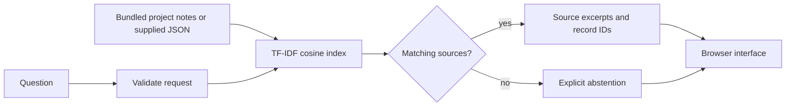
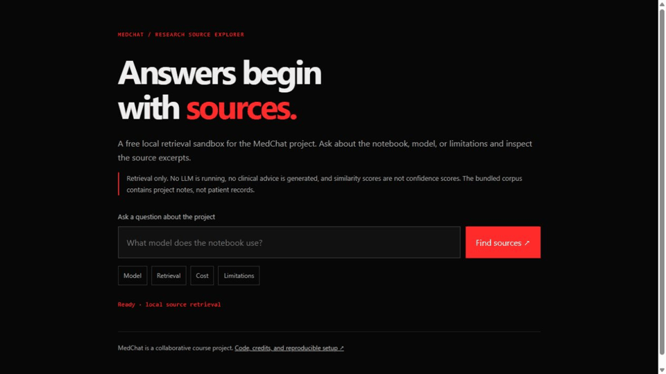

# MedChat — medical LLM research, with a free local source explorer

A collaborative Indiana University course project exploring biomedical language models and retrieval. The runnable path in this checkout is a **source-retrieval demo**: it returns project-note excerpts with citations and abstains when no source matches. It does not load an LLM or generate medical advice.

## Problem

Medical LLM research is difficult to review when the interface depends on an old tunnel and the model, data, and measurements are not packaged with the code. This repository separates what can run locally today from the archived research experiment.

## Approach

- **Runnable local demo:** Python/Flask, deterministic TF-IDF cosine retrieval, explicit source IDs, input validation, and no shared conversation storage.
- **Archived experiment:** BioMistral-7B, BitsAndBytes NF4, MiniLM embeddings, and FAISS IndexIVFFlat in `LLM Server.ipynb`. This is a different path, with external data and GPU requirements.
- **Interface repair:** the React client now targets a configurable localhost backend, shows failures, returns source citations, and clears browser-local history.

## Result and evidence

The free local demo is reproducible without API keys, Hugging Face credentials, a GPU, or a model download. Backend and frontend checks cover behavior, not clinical quality.

**No hallucination-reduction, GPU-memory, or production-latency result is established by the artifacts in this checkout.** No trained adapter, held-out medical evaluation set, or production benchmark log is included. See [verification and limits](docs/VERIFICATION.md) and [the measurement plan](docs/MEASUREMENT_PLAN.md).

The [original course report](docs/historical-report.md) is preserved for attribution and history. Its numerical and comparative claims are unverified here and must not be treated as current benchmark results.

## Architecture



This diagram describes the tested local demo. It does not represent a deployed LLaMA/QLoRA system or a clinical evaluation harness.

## How to run

Use Python 3.12. From a fresh clone:

```bash
git clone https://github.com/mofahad/MedChat-llm.git
cd MedChat-llm
python -m venv .venv
```

Activate the environment:

```powershell
# Windows PowerShell
.venv\Scripts\Activate.ps1
```

```bash
# macOS / Linux
source .venv/bin/activate
```

Then:

```bash
python -m pip install -r requirements.txt
python app.py
```

Open **http://127.0.0.1:5005**. Ask “What model does the notebook use?” or select an example question. The bundled corpus contains project implementation notes, not patient records.

To use your own permitted source notes, provide a JSON list of records with nonempty `id`, `title`, `text`, and `source` strings:

```bash
python app.py --corpus path/to/notes.json
```

The server binds to localhost and does not save queries. Retrieval similarity is a lexical ranking signal, not a probability of correctness.

### Optional React interface

Keep the backend running, then:

```bash
cd frontend
npm ci
npm start
```

Open http://localhost:3000. The backend defaults to http://127.0.0.1:5005. Set `REACT_APP_API_URL` before starting React to change it; `frontend/.env.example` shows the format. No tunnel is needed.

## Checks

```bash
python -m unittest test_app -v
cd frontend
npm test -- --watchAll=false --runInBand
npm run build
```

The GitHub Actions workflow runs regression checks on pushes and pull requests. It is **not** a clinical evaluation score badge: no runnable medical answer-evaluation harness was present in the original checkout, and none is being simulated.

### Preserved external-data backend and notebook repairs

The earlier repair's `backend.py`, `requirements-local.txt`, and `test_backend.py` are preserved for a supplied Question/Answer CSV. Install `requirements-local.txt`, set `MEDICAL_CSV` to a permitted CSV, set `APP_DOMAIN=medical`, and run `python backend.py`. The React client can use this same local API. Its data path is optional; no external CSV is included or required for `python app.py`.

To run all backend checks, install `requirements-local.txt` and run `python -m unittest test_app test_backend test_medical_csv -v`. The original notebook's variable, model-placement, source-index, shared-history, logging, and credential-cleanup repairs are also preserved. They are static repairs; end-to-end GPU inference remains unvalidated. Earlier repair notes in `REPAIR_STATUS.md` describe prior-session observations, not new measurements from this update.

## See it work



This recording shows the implemented source explorer searching bundled project notes. It does not show LLM inference.

## Live demo

There is no verified hosted demo yet. Run the local demo above, or follow the [prepared manual hosting steps](docs/HOSTING.md) later. Those steps need a browser account, not an API key; the Docker/hosted path has not been tested here. Do not reuse historical temporary tunnel links. The existing notebook requires additional data, compatible GPU software, and model artifacts; that path has not been revalidated. No old credential has been renewed or assumed valid.

## Tech stack

Python · Flask · TF-IDF/cosine retrieval · React · unittest · React Testing Library

Archived research: PyTorch · Transformers · BioMistral · BitsAndBytes · SentenceTransformers · FAISS

## Team and attribution

Original project repository: [Ramcharxn/medchat-llm](https://github.com/Ramcharxn/medchat-llm).

The original report credits **Ramcharan Suresh, Prathibha Gandikota Bhaskar, Mohammed Fahad Shahul Hameed, and Sushil Amalan John Moses**. It attributes research design, frontend and Gradio work, benchmark experiments, and report writing to Fahad. Preserve the full contribution statement in the archived report; this is a team project.

Contact: [md.fahad.sh@gmail.com](mailto:md.fahad.sh@gmail.com) · [GitHub](https://github.com/mofahad)
